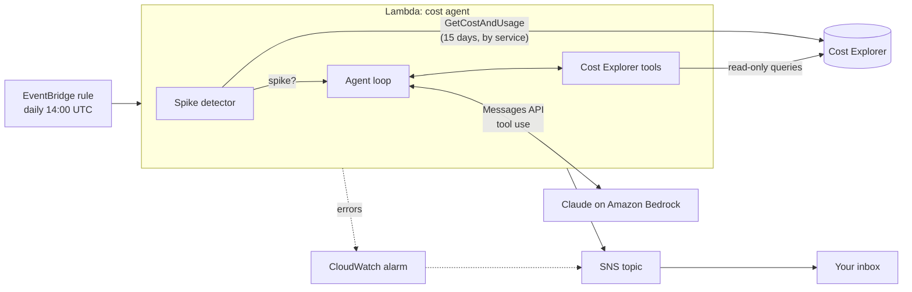

# AWS Cost Alert Agent

An AI agent that checks your AWS bill once a day, spots spend spikes, and emails you a plain-language explanation of what changed and what to check.

* **Amazon EventBridge** runs the check every day.
* **AWS Cost Explorer** supplies daily cost per service.
* A small statistical detector decides whether yesterday was a real spike, so the AI only runs when it is needed.
* **Claude on Amazon Bedrock** investigates the spike. It chooses which read-only Cost Explorer queries to run (by service, usage type, region, daily trend), reads the results, and writes the explanation.
* **Amazon SNS** emails the explanation with the raw numbers underneath. A CloudWatch alarm emails you if the checker itself fails.

Everything is defined with the **AWS CDK (Python)** and deploys as one small stack. Step-by-step setup is in **[DEPLOY.md](DEPLOY.md)**.

## Architecture



How one run works:

1. EventBridge invokes the Lambda each day at 14:00 UTC, when yesterday's Cost Explorer data has mostly settled.
2. The Lambda fetches the last 15 days of cost grouped by service and runs the spike detector.
3. On a quiet day it stops there. Cost: one Cost Explorer request ($0.01).
4. On a spike it starts an agent loop with Claude. Claude sees the spike summary and three tools, asks for the queries it wants, gets the results, and repeats until it can explain the spike. The loop allows at most 6 tool calls.
5. The explanation and the raw numbers go out by email through SNS. If the AI step fails, the email still goes out with the numbers.

### How a spike is defined

Yesterday's total spend is compared with the mean of the previous 14 days. All three must hold:

| Check | Default | Why |
| --- | --- | --- |
| Percent above baseline | 30% | Catches real jumps |
| Absolute increase | $5 | Ignores +900% on a $0.10 bill |
| z-score vs history | 2.0 | Ignores accounts whose spend is normally bumpy |

Credits and refunds are excluded so they don't hide usage. All thresholds are CDK context values.

### The agent

`lambdas/cost_agent/explainer.py` is a short agent loop on the Anthropic Messages API, called through Bedrock's `bedrock-mantle` endpoint with the official `anthropic` Python SDK and the Lambda role's IAM credentials.

| Tool | What it returns |
| --- | --- |
| `get_cost_by_service` | Top services by cost for a date range |
| `get_service_breakdown` | One service split by usage type, region, operation, instance type, purchase type or account |
| `get_daily_trend` | Daily cost for the account or one service |

Guardrails:

* Tools are read-only and validate their inputs, and date ranges are capped at 90 days.
* A hard limit of 6 tool calls per spike (each Cost Explorer request costs $0.01).
* The prompt tells Claude to use only numbers from the summary or tool results, and to say so when the data doesn't explain the spike.

Example email (illustrative, not from a real account):

> What happened: Spend on 2026-11-20 was $61.40, up $49.80 (+430%) from a $11.60 daily baseline.
> Likely cause: EC2 - Other rose $46.10, almost all in USE1-NatGateway-Bytes in us-east-1. NAT gateway data processing usually grows when something in a private subnet starts pulling a lot of data from the internet or S3 without a VPC endpoint.
> What to check: 1) VPC Flow Logs for the NAT gateway's top talkers. 2) Whether the VPC has an S3 gateway endpoint. 3) Recent deploys of batch jobs or containers that pull large images.
> Is it expected? This looks like new runaway usage, not a one-off: the daily trend shows it rising for three days.

### Why not Bedrock Agents?

The first version used Bedrock Agents. CloudFormation reports `AWS::Bedrock::Agent` as **in maintenance mode since 2026-06-30**, so this version runs the agent loop itself. That means fewer resources (one Lambda, no agent, alias or action group), and every step is visible and unit-tested in plain Python.

## Project layout

```
app.py                          CDK entry point
cdk.json                        CDK config and tunable context values
cost_alert_agent/stack.py       Infrastructure: SNS, Lambda, IAM, EventBridge, CloudWatch alarm
lambdas/cost_agent/
  handler.py                    Lambda entry: fetch costs, detect, explain, email
  detector.py                   Pure spike-detection logic
  explainer.py                  Claude agent loop (Messages API on Bedrock)
  tools.py                      Read-only Cost Explorer tools and their schemas
  requirements.txt              Lambda dependencies (anthropic SDK)
tests/                          pytest unit tests, AWS and model calls mocked
DEPLOY.md                       Step-by-step deploy, test and teardown guide
```

## Quick start

```bash
python3 -m venv .venv && source .venv/bin/activate
pip install -r requirements-dev.txt
pytest -q
cdk bootstrap                      # once per account and region
cdk deploy -c alert_email=you@example.com
```

Then confirm the SNS subscription email. See [DEPLOY.md](DEPLOY.md) for prerequisites, model access, testing and troubleshooting.

## Configuration

Pass with `-c key=value` or edit `cdk.json`:

| Context key | Default | Meaning |
| --- | --- | --- |
| `alert_email` | empty | Email subscribed to the alerts topic |
| `model_id` | `anthropic.claude-opus-5-5` | Claude model on Bedrock |
| `bedrock_region` | stack region | Region of the Bedrock endpoint |
| `effort` | `medium` | Claude effort level (`low`, `medium`, `high`) |
| `max_tool_calls` | 6 | Cost Explorer calls the agent may make per spike |
| `schedule_cron` | `cron(0 14 * * ? *)` | When the check runs (UTC) |
| `lookback_days` | 14 | Days of history in the baseline |
| `pct_threshold` | 30 | Minimum percent increase |
| `min_abs_increase` | 5 | Minimum increase in USD |
| `z_threshold` | 2 | Minimum z-score |

To cut model cost, use `-c model_id=anthropic.claude-haiku-5-5` or `-c effort=low`.

## Cost to run

For a personal account, expect well under $1 a month plus a few cents per spike:

| Item | Estimate |
| --- | --- |
| Cost Explorer API ($0.01 per request) | 1 a day, plus up to 6 per spike: about $0.30 to $0.50 a month |
| Lambda, EventBridge, SNS email, CloudWatch | Within the free tier at this volume |
| Claude on Bedrock | Only on spike days: a few thousand tokens, a few cents per explanation |

## Security

* The Lambda role can only read cost data (`ce:GetCostAndUsage`), call Claude on Bedrock (`bedrock-mantle:CreateInference`), and publish to its own topic. It cannot change any resource.
* No API keys: Bedrock calls are signed with the Lambda role's temporary credentials.
* Cost data stays in your AWS account and Bedrock; only the alert email leaves AWS.

## Ideas to extend

* Add AWS Cost Anomaly Detection (`ce:GetAnomalies`) as a second signal.
* Post to Slack or Microsoft Teams through Amazon Q Developer in chat applications or a webhook.
* Keep each explanation in DynamoDB and send a weekly digest.
* Add per-tag or per-account breakdowns for AWS Organizations.
